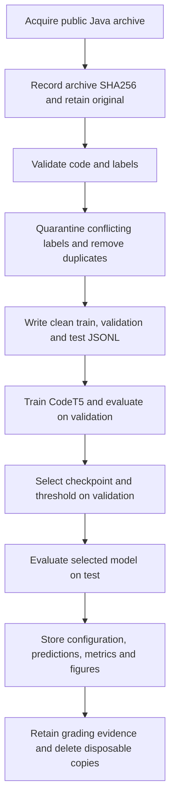
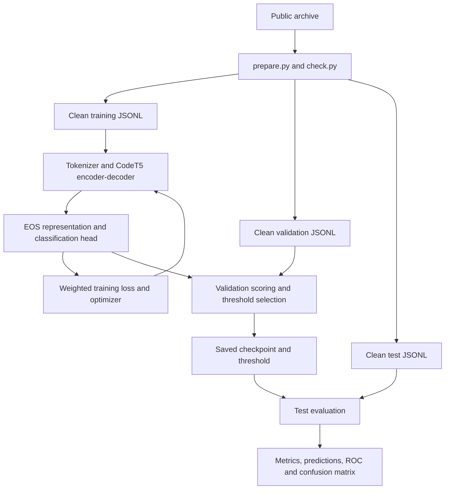
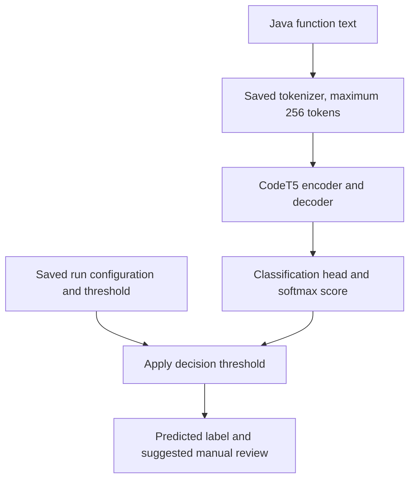
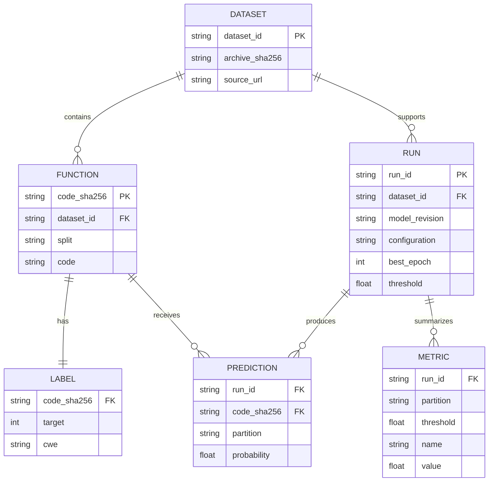

# Project diagrams

These diagrams describe the implemented file-based pipeline and its conceptual data relationships. They do not represent a deployed SQL database or a production review service.

## Data lifecycle

The final retention/deletion step is a proposed policy, not an automated script. The original archive and derived hashes provide provenance; hashes do not themselves prove correct labels or authorized data use.

## ETL

| Stage | Implementation |
| --- | --- |
| Extract | `prepare.py` downloads the archive when absent and reads JSONL members |
| Transform | Check nonempty code and integer binary labels; compute normalized-code SHA256; remove conflicting labels and duplicate hashes |
| Load | Write clean JSONL partitions, consumed by the model's Dataset and DataLoader |

Global duplicate checking uses memory. Training uses minibatches but loads JSONL records into memory; this is not an end-to-end streaming system.

## Training and evaluation architecture

V2 class weights are computed from training counts only. Checkpoint selection uses validation F1 with average precision as a tie-breaker. The original V2 threshold maximizes validation F1; the report's additional accuracy-constrained policy requires its separate postprocessing code and evidence. Test results do not feed the selection functions, but the overall development process reused test results between experiments, as disclosed in the README.

## Inference architecture

Input features contain code only. Ground-truth labels and CWE metadata are not passed to the model as predictor inputs. Manual review is a recommended use, not an implemented review-queue application.

## Conceptual ER model

Prediction identity is the combination of run and function. Metric identity additionally includes partition, decision threshold and metric name. Conceptual entities are represented across JSONL and JSON files; there are no SQL foreign-key constraints in the implementation.
